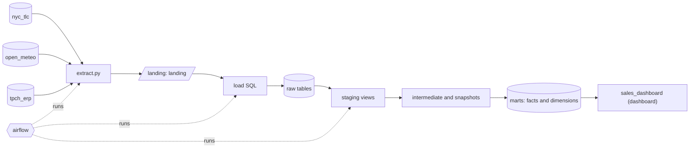

# 0. Overview

What commerce is built from, and what you need before you start.

Work through the chapters in order: each builds on the one before. Every script a step runs is in this folder, so nothing here needs Murakumo.

| Part | Choice |
| --- | --- |
| Warehouse | duckdb |
| Extract (fetching the data) | python |
| Landing (where fetched files land) | landing |
| Load (landed files into raw tables) | build |
| Transform | dbt |
| Python | none |
| Orchestrator | airflow |
| CI | github |

| What | How many |
| --- | --- |
| Sources | 3 |
| Raw tables | 12 |
| Models (staging, intermediate, marts) | 23 |
| Snapshots (history) | 1 |
| Tests | 113 |
| Exposures (dashboards, apps) | 1 |

## 0.1 Read the architecture

**Why:** Data moves one way: fetched from the sources, landed as files, loaded into raw tables, then transformed layer by layer into the marts that dashboards and apps read.



- [ ] Read the architecture

## 0.2 Install the tools

**Why:** These are the only tools the platform needs. The versions are the oldest that work.

| Tool | Version | For |
| --- | --- | --- |
| git | any recent version | the repository and its branches |
| Python | 3.11 or later (3.9 or later for the extract script alone) | dbt and the extract code |
| dbt-core | 1.10 or later | the transformations: `pip install 'dbt-core>=1.10' dbt-duckdb` |
| duckdb | 1.1 or later | the warehouse |
| duckdb CLI | 1.1 or later | running the plain SQL scripts |
| airflow | see generated/orchestration/airflow/README.md | the schedules |

```bash
python3 --version
pip install 'dbt-core>=1.10' dbt-duckdb
dbt --version
```

**You should see:** dbt's version, and the dbt-duckdb plugin under Plugins.

- [ ] Install the tools

---

Generated by Murakumo 0.9.0 for commerce. [Back to the guide](README.md)
