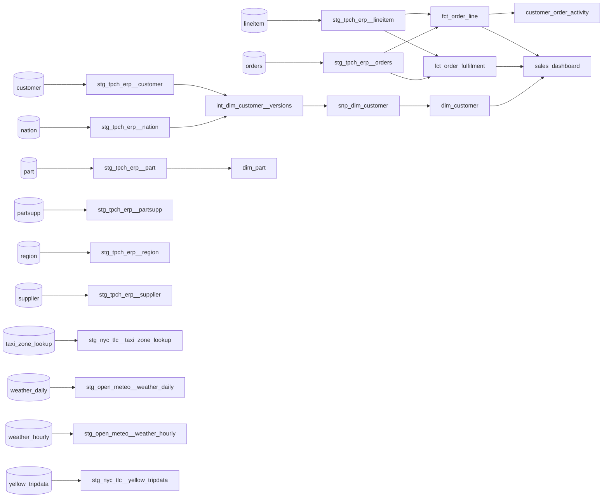

# 9. Reference

The data dictionary of every mart, the bus matrix, lineage, the dashboards and apps that read the marts, and what is masked.

| Exposure | Type | Owner | Reads | Link |
| --- | --- | --- | --- | --- |
| sales_dashboard | dashboard | Sales analytics sales-analytics@example.com | fct_order_line, fct_order_fulfilment, dim_customer | https://bi.example.com/dashboards/sales |

| Column | Masked because | Shows |
| --- | --- | --- |
| dim_customer.customer_name | pii | redact |
| dim_customer.phone | pii | redact |

## 9.1 The bus matrix

**Why:** Which business processes (facts) share which dimensions. A conformed dimension is one table every fact that needs it uses, so numbers agree across domains.

| Fact (process) | Domain | dim_part (conformed) | dim_customer (conformed) |
| --- | --- | --- | --- |
| fct_order_fulfilment | sales |  | ✓ |
| fct_order_line | sales | ✓ | ✓ |

- [ ] The bus matrix

## 9.2 Lineage

**Why:** Which tables each table is built from.

- [ ] Lineage

## 9.3 customer_order_activity

**Why:** Each customer's whole order history, one row per customer per day. Grain: customer_id.

| Column | Type | Nullable | Description | Notes |
| --- | --- | --- | --- | --- |
| customer_id | bigint (BIGINT) | no |  |  |

- [ ] customer_order_activity

## 9.4 dim_customer

**Why:** Customers, with every change to their segment, balance or country kept as a new version.

| Column | Type | Nullable | Description | Notes |
| --- | --- | --- | --- | --- |
| customer_id | bigint (BIGINT) | no |  | primary key |
| customer_name | string (VARCHAR) | yes |  | PII; restricted |
| phone | string (VARCHAR) | yes |  | PII; restricted |
| nation_name | string (VARCHAR) | yes |  |  |
| market_segment | string (VARCHAR) | yes |  | one of AUTOMOBILE, BUILDING, FURNITURE, HOUSEHOLD, MACHINERY |
| account_balance | money (DECIMAL(18,4)) | yes |  |  |

- [ ] dim_customer

## 9.5 dim_part

**Why:** Parts we sell.

| Column | Type | Nullable | Description | Notes |
| --- | --- | --- | --- | --- |
| part_id | bigint (BIGINT) | no |  | primary key |
| part_name | string (VARCHAR) | yes |  |  |
| brand | string (VARCHAR) | yes |  |  |
| retail_price | money (DECIMAL(18,4)) | yes |  |  |

- [ ] dim_part

## 9.6 fct_order_fulfilment

**Why:** One row per order line, following it from order to shipment to receipt. Grain: order_id, line_number.

| Column | Type | Nullable | Description | Notes |
| --- | --- | --- | --- | --- |
| order_id | bigint (BIGINT) | no |  |  |
| line_number | integer (INTEGER) | no |  |  |
| customer_id | bigint (BIGINT) | yes |  |  |
| ordered_on | date (DATE) | yes |  |  |
| committed_on | date (DATE) | yes | When the line was promised to ship. |  |
| shipped_on | date (DATE) | yes |  |  |
| received_on | date (DATE) | yes |  |  |

- [ ] fct_order_fulfilment

## 9.7 fct_order_line

**Why:** One row per order line, with its net amount after discount. Grain: order_id, line_number.

| Column | Type | Nullable | Description | Notes |
| --- | --- | --- | --- | --- |
| order_id | bigint (BIGINT) | no |  |  |
| line_number | integer (INTEGER) | no |  |  |
| customer_id | bigint (BIGINT) | no |  |  |
| part_id | bigint (BIGINT) | no |  |  |
| ordered_on | date (DATE) | no |  |  |
| order_status | string (VARCHAR) | yes |  | one of F, O, P |
| quantity | decimal(15,2) (DECIMAL(15,2)) | yes |  |  |
| net_amount | money (DECIMAL(18,4)) | yes | Extended price after discount, before tax. |  |

- [ ] fct_order_line

---

Generated by Murakumo 0.9.0 for commerce. [Back to the guide](README.md)
